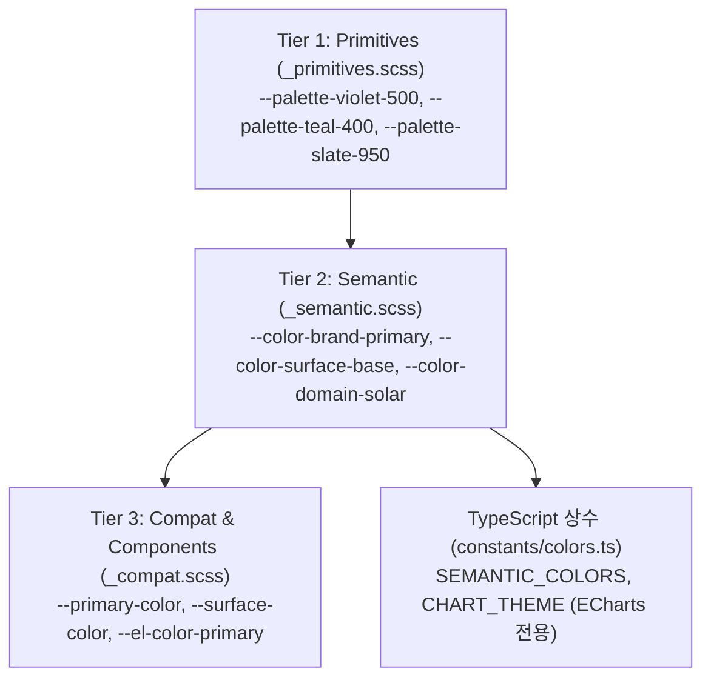

# Solar EMS 디자인 시스템 컬러 가이드 (Color System Guide)

본 문서는 Solar EMS 프로젝트의 UI/UX 일관성과 유지보수성을 보장하기 위해 구축된 **3-Tier 컬러 토큰 시스템**의 사용 규칙 및 가이드라인입니다.

---

## 1. 아키텍처 개요 (3-Tier Token Architecture)

Solar EMS는 컴포넌트에 색상 값을 직접 바인딩하지 않고, 역할과 의미에 따라 3단계로 추상화하여 관리합니다.



* **Tier 1 (Primitives)**: 물리적 색상명과 명도 스케일 (순수 HEX 및 표준 Alpha 투명도)
* **Tier 2 (Semantic)**: UI 내에서의 **역할과 의미(의도)**를 부여한 토큰 (Surface, Text, Status, EMS Domain, Chart)
* **Tier 3 (Compatibility)**: 기존 스타일 및 Element Plus 라이브러리와의 100% 하위 호환을 보장하는 Alias 레이어
* **TypeScript 동기화**: SCSS 토큰과 1:1로 일치하는 상수(`SEMANTIC_COLORS`, `CHART_THEME`)를 제공하여 ECharts 등 스크립트 영역에서 사용

---

## 2. 컬러 토큰 레퍼런스

### ① Brand Colors (브랜드 & 액센트)

| SCSS 변수명 | TS 프로퍼티 | 기본값 | 용도 및 설명 |
| :--- | :--- | :--- | :--- |
| `--color-brand-primary` | `SEMANTIC_COLORS.brand.primary` | `#e76dff` | 브랜드 메인 네온 바이올렛, 주요 CTA 버튼, 선택 탭 |
| `--color-brand-secondary` | `SEMANTIC_COLORS.brand.secondary` | `#15e0b7` | 보조 액센트, 정상/활성 지표, 태양광 발전 |
| `--color-brand-accent-soft` | - | `rgba(231, 109, 255, 0.24)` | 바이올렛 버튼 호버/선택 배경 |
| `--color-brand-primary-soft` | - | `rgba(231, 109, 255, 0.18)` | 메뉴 호버 및 부드러운 강조 배경 |

---

### ② Surface & Elevation (배경 및 패널 4단계)

다크 테마의 깊이감(Elevation)을 표현하기 위해 4단계 계층을 엄격히 준수합니다.

| 계층 | SCSS 변수명 | TS 프로퍼티 | 기본값 | 사용처 |
| :--- | :--- | :--- | :--- | :--- |
| **Canvas** | `--color-surface-deep` | `SEMANTIC_COLORS.surface.deep` | `#151822` | 전체 브라우저 바탕 배경, 좌측 고정 사이드바 |
| **Base** | `--color-surface-base` | `SEMANTIC_COLORS.surface.base` | `#171a24` | 메인 페이지 컨테이너, 폼 컨트롤 박스 |
| **Panel** | `--color-surface-panel` | `SEMANTIC_COLORS.surface.panel` | `#181b25` | ECharts 차트 패널, 대시보드 위젯 컨테이너 |
| **Elevated** | `--color-surface-elevated` | `SEMANTIC_COLORS.surface.elevated`| `#1d2130` | 모달 팝업, 드롭다운 메뉴, 툴팁, 플로팅 카드 |
| **Glass** | `--color-surface-glass` | `SEMANTIC_COLORS.surface.glass` | `rgba(24, 27, 37, 0.48)` | 글래스모피즘 반투명 카드 오버레이 |

---

### ③ Typography (텍스트 위계)

WCAG 명도 대비를 고려하여 명확한 정보 위계를 가집니다.

| SCSS 변수명 | TS 프로퍼티 | 기본값 | 권장 용도 |
| :--- | :--- | :--- | :--- |
| `--color-text-high` | `SEMANTIC_COLORS.text.high` | `#ffffff` | 최상위 고대비 텍스트, 모달 제목, 핵심 KPI 숫자 |
| `--color-text-primary` | `SEMANTIC_COLORS.text.primary` | `#f5f5f5` | 화면 헤더 타이틀, 테이블 헤더, 주요 폼 라벨 |
| `--color-text-strong` | `SEMANTIC_COLORS.text.strong` | `#f4f1f8` | 활성화된 메뉴 텍스트, 강조 본문 |
| `--color-text-body` | `SEMANTIC_COLORS.text.body` | `#d8d1e0` | 일반 본문 텍스트, 설명 문구, 테이블 셀 데이터 |
| `--color-text-secondary`| `SEMANTIC_COLORS.text.secondary`| `#c9c1d4` | **차트 X/Y축 라벨, 범례(Legend), 보조 라벨** |
| `--color-text-muted` | `SEMANTIC_COLORS.text.muted` | `#9f98aa` | 비활성화된 항목, 날짜/시간 보조 메타데이터 |
| `--color-text-placeholder`| `SEMANTIC_COLORS.text.placeholder`| `rgba(255,255,255,0.38)` | 검색창 및 인풋 플레이스홀더 텍스트 |

---

### ④ Border & Divider (경계선 및 분할선)

| SCSS 변수명 | TS 프로퍼티 | 기본값 | 용도 |
| :--- | :--- | :--- | :--- |
| `--color-border-subtle` | `SEMANTIC_COLORS.border.subtle` | `rgba(255, 255, 255, 0.08)` | 카드 패널 외곽선, 테이블 행 구분선, 차트 그리드선 |
| `--color-border-strong` | `SEMANTIC_COLORS.border.strong` | `rgba(255, 255, 255, 0.16)` | 모달 경계선, 인풋 박스 테두리, 차트 축선(Axis Line) |
| `--color-border-brand` | `SEMANTIC_COLORS.border.brand` | `rgba(231, 109, 255, 0.24)` | 선택/활성 상태의 컨트롤 테두리 |
| `--color-border-focus` | `SEMANTIC_COLORS.border.focus` | `#dedede` | 키보드 포커스 링 |

---

### ⑤ EMS Domain Specific (EMS 도메인 전용 컬러)

에너지 흐름 및 주요 설비별 표준 색상입니다.

| 도메인 항목 | SCSS 변수명 | TS 프로퍼티 | 대표 색상 | 의미 |
| :--- | :--- | :--- | :--- | :--- |
| **태양광 (Solar)** | `--color-domain-solar` | `SEMANTIC_COLORS.domain.solar` | `#15e0b7` (Teal) | 태양광 발전량, 자립률 |
| **배터리 (Battery/ESS)**| `--color-domain-battery`| `SEMANTIC_COLORS.domain.battery`| `#e76dff` (Magenta)| ESS 충/방전, 배터리 SOC |
| **계통망 (Grid)** | `--color-domain-grid` | `SEMANTIC_COLORS.domain.grid` | `#4ca5d7` (Blue) | 한전 계통 연계, 수전/송전 |
| **부하 (Load)** | `--color-domain-load` | `SEMANTIC_COLORS.domain.load` | `#f19c4d` (Orange)| 공장/수용가 전력 소비량 |

---

### ⑥ Status & Alerts (상태 및 경보)

| 상태 | SCSS 변수명 | TS 프로퍼티 | 대표 색상 | 적용 대상 |
| :--- | :--- | :--- | :--- | :--- |
| **Danger / Alarm** | `--color-status-danger` | `SEMANTIC_COLORS.status.danger` | `#ff383c` | 심각 알람, 에러 배지, 긴급 정지 |
| **Warning / Caution**| `--color-status-warning`| `SEMANTIC_COLORS.status.warning`| `#f19c4d` | 경고 알람, 주의 배지 |
| **Success / Normal** | `--color-status-success`| `SEMANTIC_COLORS.status.success`| `#56ba64` | 정상 가동, 연결 성공, 목표 달성 |
| **Info / Notice** | `--color-status-info` | `SEMANTIC_COLORS.status.info` | `#4ca5d7` | 일반 안내, 연결 대기 |

---

## 3. 코드 사용 가이드

### ① SCSS / Vue `<style>`에서 사용 시

컴포넌트 스타일 작성 시 **반드시 CSS 변수(시맨틱 토큰)**를 사용합니다.

```scss
// ✅ 권장 (Do)
.my-custom-card {
  background-color: var(--color-surface-panel);
  border: 1px solid var(--color-border-subtle);
  color: var(--color-text-body);

  .title {
    color: var(--color-text-high);
  }

  .solar-metric {
    color: var(--color-domain-solar);
  }
}

// ❌ 금지 (Don't)
.bad-card {
  background-color: #181b25; // 하드코딩 금지
  border: 1px solid rgba(255, 255, 255, 0.08); // 하드코딩 금지
  color: #fff; // 하드코딩 금지
}
```

---

### ② ECharts 및 TypeScript 파일에서 사용 시

`@/constants/colors`에서 `CHART_THEME` 또는 `SEMANTIC_COLORS`를 가져와 사용합니다.

```typescript
import { computed } from 'vue'
import type { EChartsOption } from 'echarts'
import { CHART_THEME, SEMANTIC_COLORS } from '@/constants/colors'

const chartOption = computed<EChartsOption>(() => ({
  // 1. 도메인 표준 팔레트 사용
  color: [
    SEMANTIC_COLORS.domain.solar,
    SEMANTIC_COLORS.domain.battery,
    SEMANTIC_COLORS.domain.grid,
  ],

  // 2. 표준 툴팁 설정 적용
  tooltip: {
    trigger: 'axis',
    ...CHART_THEME.tooltip,
  },

  // 3. 축 라벨 및 그리드 선 색상 통일
  xAxis: {
    type: 'category',
    axisLabel: { color: CHART_THEME.textColor },
    axisLine: { lineStyle: { color: CHART_THEME.axisLineColor } },
  },
  yAxis: {
    type: 'value',
    axisLabel: { color: CHART_THEME.textColor },
    splitLine: { lineStyle: { color: CHART_THEME.gridLineColor } },
  },
}))
```

---

## 4. 테마 색상 변경 방법 (신규 테마/브랜드 변경 시)

전체 시스템 색상을 변경할 때는 다음 3개 파일만 수정하면 전역에 자동 반영됩니다:

1. **`src/assets/styles/tokens/_primitives.scss`**
   - 새로운 브랜드 대표 HEX 코드 수정 (예: `--palette-violet-500`)
2. **`src/assets/styles/tokens/_semantic.scss`**
   - 시맨틱 역할에 매핑된 프리미티브 참조 조정
3. **`src/constants/colors.ts`**
   - TypeScript 상수 동기화 (`PRIMITIVE_COLORS`, `SEMANTIC_COLORS`)
